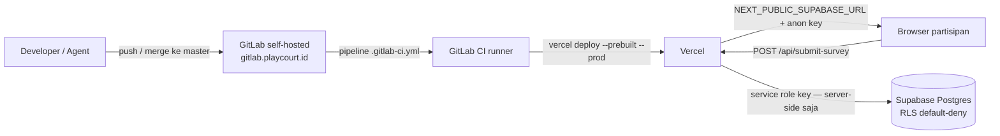

# Deployment Produksi — Vercel + Supabase

Runbook deploy produksi aplikasi eksperimen pajak (BETE-12). Stack: **GitLab CI → Vercel (hosting Next.js) → Supabase (Postgres)**.

## Arsitektur



- **Hosting:** Vercel menjalankan Next.js. Karena repo ada di GitLab self-hosted (integrasi Git native Vercel butuh konfigurasi admin), deploy dilakukan **Vercel CLI dari GitLab CI**.
- **Database:** Supabase. Semua tulisan DB lewat server (service role di API route); browser tidak pernah berbicara langsung ke tabel. RLS default-deny.
- **Secrets:** hanya hidup di dua tempat — dashboard Vercel (env runtime) dan GitLab CI variables (token deploy). Tidak pernah di repo, issue, atau chat.

## Setup awal (sekali, oleh owner)

### 1. Supabase — migrasi & kredensial

1. Project dibuat di supabase.com (free tier memadai).
2. Jalankan migrasi **berurutan** lewat Dashboard → SQL Editor (copy-paste → Run, satu per satu):
   - `supabase/migrations/0001_init.sql`
   - `supabase/migrations/0002_submit_survey_rpc.sql`
   - `supabase/migrations/0003_manipulation_check.sql`
3. Verifikasi RLS — lihat [§ Verifikasi RLS](#verifikasi-rls).
4. Ambil nilai dari **Project Settings → API (Data API)**:
   - Project URL → dipakai untuk `NEXT_PUBLIC_SUPABASE_URL`
   - `anon` / `publishable` key → `NEXT_PUBLIC_SUPABASE_ANON_KEY`
   - `service_role` / `secret` key → `SUPABASE_SERVICE_ROLE`

   Nilai tidak pernah dikirim ke siapa pun lewat chat, issue, atau email.

### 2. Vercel — project & environment variables

1. Buat akun di vercel.com, lalu dari root repo lokal:
   ```bash
   npm i -g vercel
   vercel login
   vercel link      # pilih atau create project, mis. "assessment"
   ```
2. File `.vercel/project.json` (tidak di-commit) berisi `orgId` dan `projectId` — dua nilai ini untuk langkah GitLab di bawah.
3. Isi Environment Variables lewat dashboard → Settings → Environment Variables, environment **Production** (atau `vercel env add <NAMA> production`):

   | Nama | Keterangan |
   |---|---|
   | `NEXT_PUBLIC_SUPABASE_URL` | URL project Supabase |
   | `NEXT_PUBLIC_SUPABASE_ANON_KEY` | anon key (dibatasi RLS, aman untuk browser) |
   | `SUPABASE_SERVICE_ROLE` | service role — **SERVER ONLY**, jangan pernah di-prefix `NEXT_PUBLIC_` |

### 3. GitLab — CI variables

Dashboard GitLab repo → **Settings → CI/CD → Variables**, tambahkan (centang *Masked*):

| Variabel | Nilai dari |
|---|---|
| `VERCEL_TOKEN` | vercel.com → Account Settings → Tokens → Create |
| `VERCEL_ORG_ID` | `.vercel/project.json` → `orgId` |
| `VERCEL_PROJECT_ID` | `.vercel/project.json` → `projectId` |

> Jika branch `master` protected, centang juga *Protected* agar variabel tersedia untuk pipeline master.

Selesai — pipeline otomatis aktif pada push berikutnya.

## Alur deploy (promote)

1. Merge ke `master` lewat jalur normal (branch `bete-*` → merge, tanpa force-push).
2. GitLab CI menjalankan dua stage:
   - **build** (semua branch): `npm ci` → `npm run lint` → `npm test` → `npm run build`. Pipeline merah = tidak ada deploy.
   - **deploy:prod** (hanya `master`): `vercel pull` (ambil build settings + env Production) → `vercel build --prod` → `vercel deploy --prebuilt --prod`.
3. Monitor di GitLab → CI/CD → Pipelines; URL produksi dan riwayat deployment di Vercel dashboard → Deployments.

## Rollback

- **Aplikasi (Vercel):** dashboard → Deployments → pilih deployment produksi sebelumnya yang sehat → menu ⋯ → **Promote to Production** (instan, tanpa rebuild). Lewat CLI: `vercel promote <deployment-url>`.
- **Database (Supabase):** migrasi bersifat aditif dan tidak diotomasi rollback-nya. Kembali ke kondisi sebelumnya = restore dari backup (lihat di bawah); versi aplikasi lama tetap kompatibel karena skema aditif.

## Backup & pemulihan data

Supabase free tier **tidak** menyediakan backup otomatis — jadwalkan ekspor manual:

- Setelah tiap sesi eksperimen: ekspor 4 tabel via SQL Editor (Results → export CSV), atau dump penuh:
  ```bash
  supabase db dump --db-url "<connection-string>" --file backup-$(date +%F).sql
  ```
  (connection string dari Supabase → Settings → Database; jangan pernah disimpan di repo)
- Simpan hasil ekspor di penyimpanan milik owner — bukan repo, issue, atau chat.
- Pemulihan: restore/launch ulang project Supabase, jalankan ulang migrasi bila perlu, lalu import dump/CSV terakhir.

## Verifikasi RLS

Setelah migrasi, jalankan di SQL Editor:

```sql
-- semua hasil harus t (row security aktif)
select relname, relrowsecurity from pg_class
 where relname in ('participants','sessions','case_logs','survey_results');

-- daftar policy yang terpasang
select schemaname, tablename, policyname, cmd from pg_policies;
```

Lalu uji dari luar: query tabel manapun memakai **anon key** dari klien eksternal harus ditolak atau mengembalikan 0 baris. Tertolak = RLS default-deny bekerja.

## Smoke test produksi

- [ ] Buka URL produksi → halaman Login/Informed Consent tampil.
- [ ] Jalankan satu sesi penuh dengan identitas dummy (sepakati username dengan QA agar tidak mencemari data eksperimen): consent → step 1–5 → submit.
- [ ] Cek Supabase: muncul 1 baris baru di `participants`, `sessions`, `survey_results`, dan 14 baris di `case_logs`.
- [ ] Refresh di tengah sesi: data terisi dan sisa timer tidak hilang.

## Kebijakan secrets

Tidak pernah menaruh kredensial (token, key, password, connection string) di repo, commit, issue, komentar, atau chat. Jika terlanjur bocor: **rotasi segera** — Supabase (Settings → API → regenerate key) lalu perbarui nilai di Vercel; `VERCEL_TOKEN` dirotasi di vercel.com bila yang bocor token deploy.
